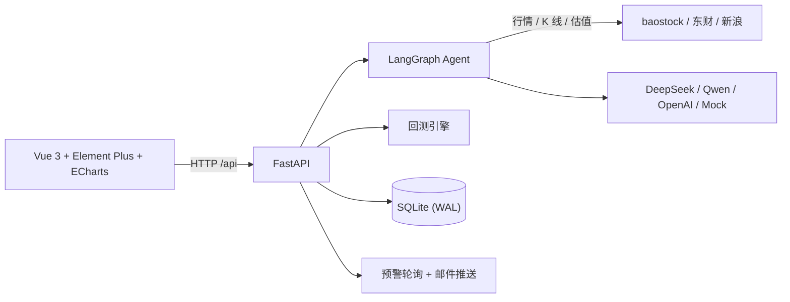

# 衡策 · A 股智能投研平台

[](https://github.com/zhuruixuan11/zrxx/actions/workflows/ci.yml)
[](LICENSE)


## 项目介绍

**衡策**是一个可完全本地部署的 A 股智能投研平台：真实行情 + 技术指标 + AI 分析 + 策略回测 + 模拟持仓 + 到价预警，覆盖从「看盘」到「验证想法」的完整链路。

做这个项目的初衷：市面上的投研工具要么依赖付费数据源，要么要把数据传到第三方服务，「数据从哪来、AI 凭什么给结论」都不透明。衡策把所有环节放在本地——行情来自免费公开接口，AI 回答被强制约束在真实数据范围内，不给目标价、不空谈，分析结论还能一键进回测用历史数据验证。

### 核心亮点

- **数据真实可查**：全市场 5000+ 只股票的实时快照与日 K 线（沪深 + 北交所），全部来自免费接口（baostock / 东方财富 / 新浪 / akshare），无需注册任何 Key；AI 不配 LLM Key 时自动进入 Mock 模式，完整流程仍可体验
- **AI 有据可依**：LangGraph Agent 自动注入行情、估值（PE/PB）、技术指标（MA/RSI/60 日位置/波动率/量比），提示词硬约束「只能引用给定数据、缺失写明数据不足」；分析类回答可一键跳转回测页验证
- **策略回测闭环**：多策略、参数可调、历史记录与多策略对比，用数据说话而不是口头判断
- **一键部署**：Docker Compose 两条命令启动（nginx + uvicorn），数据持久化在本地卷
- **工程质量**：JWT 密钥强制配置、越权防护、接口限流、异常脱敏、依赖版本精确锁定、GitHub Actions CI

### 架构



## 功能

- **A 股全景**：全市场选股（涨跌幅/换手/量比排序、搜索、分页）、概念板块、涨停池
- **个股行情**：实时快照（价格/估值/量能）+ 日 K 线（沪深 + 北交所）
- **衡策智算**：自然语言问答，自动带入行情、估值、技术指标（MA/RSI/60 日位置/波动率/量比），回答严格基于给定数据；分析类问题可一键跳转回测验证
- **策略回测**：多策略、参数可调、历史记录与多策略对比
- **模拟持仓**：买卖、仓位与风险指标
- **到价预警**：价格 / 涨跌幅 / 止盈止损条件，支持站内提醒与邮件推送
- **财经快讯**：多源新闻聚合

## 技术栈

| 层 | 选型 |
|---|---|
| 前端 | Vue 3 + Vite + TypeScript + Element Plus + ECharts |
| 后端 | FastAPI + SQLAlchemy 2（async）+ SQLite（WAL） |
| Agent | LangGraph + DeepSeek / Qwen / OpenAI（可 Mock） |
| 部署 | Docker Compose（nginx + uvicorn） |

## 快速开始

### 方式一：Docker（推荐，两条命令）

```bash
cp backend/.env.example backend/.env    # 首次执行，然后按需修改配置
docker compose up -d --build
```

打开 http://localhost:8080 ，注册账号即可使用。

数据（数据库、日志）保存在命名卷 `hengce-data`，`docker compose down` 不会删除；要彻底清空用 `docker compose down -v`。

### 方式二：本地开发

**前置**：Python 3.12、Node 20+

后端：

```bash
cd backend
python -m venv .venv
source .venv/bin/activate        # Windows: .venv\Scripts\activate
pip install -r requirements.lock # 精确复现已验证版本（requirements.txt 为可升级的宽松版本）
cp .env.example .env             # 按需修改
python -m uvicorn app.main:app --host 127.0.0.1 --port 8001
```

前端（另开一个终端）：

```bash
cd frontend
npm ci
npm run dev                      # http://localhost:5173，已代理 /api 到 8001
```

## 环境变量（backend/.env）

| 变量 | 必填 | 说明 |
|---|---|---|
| `JWT_SECRET_KEY` | **是（生产必改）** | 默认值是占位串，启动会告警。生成：`python -c "import secrets;print(secrets.token_urlsafe(48))"` |
| `LLM_PROVIDER` | 否 | `mock`（默认）/ `deepseek` / `qwen` / `openai` |
| `DEEPSEEK_API_KEY` 等 | 否 | 对应 Provider 的 Key，不填则走 Mock |
| `DATABASE_URL` | 否 | 默认 SQLite；可换 PostgreSQL |
| `SMTP_*` | 否 | 不配置则只做站内提醒 |
| `CORS_ORIGINS` | 否 | 默认允许 localhost:5173 / 3000；Docker 部署由 nginx 同源转发，无需改 |
| `AGENT_CHAT_RATE_LIMIT` / `MARKET_RATE_LIMIT` | 否 | 按 IP 限流 |
| `LOG_FILE` / `LOG_LEVEL` | 否 | 日志落盘，10MB 轮转保留 7 天 |

## 数据源与网络说明

- **日 K 线**：baostock（A 股全市场）；北交所 baostock 不覆盖，自动回退新浪 K 线
- **实时快照**：东方财富 push2
- **快讯/板块**：akshare + 东方财富
- 以上接口均在国内网络下验证可用；**海外网络访问东财/新浪可能超时**，会表现为部分行情或 K 线缺失
- 交易时段外仍可查询最近收盘数据，但实时性以行情接口返回为准

## 测试

```bash
cd backend && python -m pytest tests -q   # 16 个纯函数单测
cd frontend && npm run type-check         # TypeScript 类型检查
```

## 目录结构

```
backend/
  app/
    agent/        # LangGraph 编排、意图路由、数据工具、技术指标、RAG
    api/          # 路由：auth / market / agent / backtest / portfolio / alerts / news
    models/       # SQLAlchemy 模型
    services/     # 预警轮询、回测引擎
  tests/          # pytest
  Dockerfile
frontend/
  src/views/      # 页面：Market / Agent / Backtest / Portfolio / Alerts / News
  Dockerfile
  nginx.conf
docker-compose.yml
```

## 注意事项

- **必须单进程运行**：内存缓存、baostock 会话与预警轮询都在进程内，不要开多 worker
- **依赖版本**：`requirements.lock` 是实测通过的组合。其中 `bcrypt` 锁定 `<5.0`（passlib 1.7.4 不兼容 bcrypt 5.x，升级会导致注册/登录 500）
- **安全**：`.env`、数据库、日志均已在 `.gitignore` 中排除，请勿提交真实密钥
- **免责声明**：本项目所有分析、信号与回测结果仅供学习研究，不构成任何投资建议

## License

[MIT](LICENSE)
