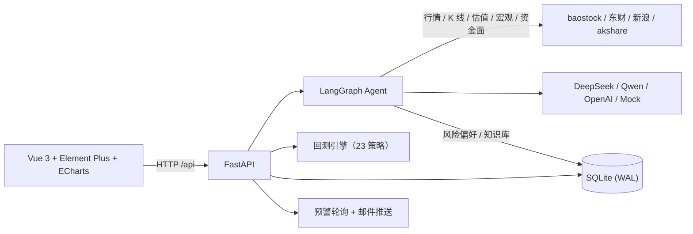

# 衡策 · A 股智能投研平台

[](https://github.com/zhuruixuan11/zrxx/actions/workflows/ci.yml)
[](LICENSE)


## 项目介绍

**衡策（Hengce）** 是一个可完全本地部署、多用户可用的 A 股智能投研平台，把「看盘 → 分析 → 验证 → 跟踪」整条投研链路装进自己的电脑：

> 全市场选股与真实行情 → AI 基于真实数据做分析 → 一键进回测用历史数据验证 → 模拟持仓与到价预警持续跟踪

## 与其他方案对比

| | 专业行情终端 | 云端 AI 工具 | **衡策** |
|---|---|---|---|
| 数据成本 | 付费订阅 | 订阅 / 免费额度 | **免费公开接口，0 Key 零注册** |
| 数据隐私 | 在厂商云端 | 持仓与提问上传第三方 | **全部留在本机** |
| AI 透明度 | — | 黑盒，无法验证 | **强制引用注入数据，结论可用回测复现** |
| 数据覆盖 | 全 | 各家不同 | **沪深 + 北交所，含宏观与资金面** |
| 多用户 | 单账号 | — | **注册登录，全链路数据隔离** |
| 自部署 | 商业客户端 | 通常不支持 | **Docker Compose 两条命令** |

## 核心优势

- **全市场真实数据，0 Key 成本** — 5500+ 只 A 股实时快照（价格 / PE / PB / 市值 / 换手 / 量比）与日 K 线，沪深 + 北交所全覆盖；baostock / 东财 / 新浪 / akshare 多源互备，单源故障自动回退，不需要注册任何数据服务
- **AI 有据可依，拒绝幻觉** — 每次回答前自动完成：意图识别 → 并行注入实时行情、估值、技术指标（MA5/10/20/60、RSI14、60 日位置、20 日年化波动率、量比）、宏观读数（GDP / CPI / M2 / SHIBOR）、资金面（大盘主力资金、龙虎榜净买居前）→ 提示词硬约束「只能引用给定数据，缺失写明数据不足」；不给目标价、不输出没有数据支撑的判断
- **分析 → 回测闭环** — 策略性回答自带「用回测验证」入口：内置 23 种策略、参数可调、历史记录与多策略对比，用历史数据检验结论，而不是听 AI 口头判断
- **认识你** — 投资画像（风险偏好 / 投资期限 / 偏好与回避板块）注入每次 AI 分析，回答贴合个人风格；支持个人 RAG 知识库（上传语料、注入问答检索）
- **毫秒级响应** — 行情 30 秒 / K 线 5 分钟 / 宏观 6 小时 / 资金面 30 分钟多级缓存 + LRU 淘汰，重复查询直接命中；相同问题 10 分钟内复用答案；LLM 超时自动重试
- **开箱即用** — Docker Compose 两条命令启动；不配 LLM Key 自动进入 Mock 模式，完整流程照样跑通；数据持久化在本地卷
- **工程可靠性** — JWT 密钥强制配置、越权防护（预警 / 数据集 / 持仓 / 聊天全链路属主校验）、接口限流、异常脱敏、依赖版本精确锁定、GitHub Actions CI（后端单测 + 前端类型检查）

## 架构



## 功能（10 个页面）

| 页面 | 能力 |
|---|---|
| 仪表盘 | 指数信号（基于指数日线的技术分析）、持仓概览、预警一览 |
| A 股全景 | 全市场选股（涨跌幅 / 换手 / 量比排序、搜索、分页）、概念板块、涨停池 |
| A 股行情 | 个股实时快照（价格 / 估值 / 量能）+ 日 K 线（沪深 + 北交所，最长一年） |
| 衡策智算 | 自然语言问答：自动带入行情、估值、技术指标、宏观、资金面；聊天记录云端持久化；分析类回答一键跳回测 |
| 数据集 | 个人 RAG 知识库：上传语料、检索注入问答、可发布共享 |
| 策略回测 | 23 种策略（趋势 / 突破 / 均值回归 / 震荡 / 动量 / 量价 / 风控七组），参数可调、历史记录、多策略对比 |
| 模拟持仓 | 买卖、仓位与风险指标，全链路按用户隔离 |
| 到价预警 | 价格 / 涨跌幅 / 止盈止损条件，站内提醒 + 邮件推送（支持测试发送） |
| 投资画像 | 风险偏好 / 期限 / 偏好板块，注入每次 AI 分析 |
| 资讯中心 | 多源财经新闻聚合 |

## 数据链路

| 数据 | 主源 | 兜底 | 缓存 |
|---|---|---|---|
| 日 K 线 | baostock | 新浪（北交所依赖此兜底） | 5 分钟 |
| 实时快照 | baostock / 东财 push2 | 新浪单股快照 | 30 秒 |
| 宏观读数 | akshare（国家统计局 / Shibor 官网） | — | 6 小时 |
| 资金面 | akshare（东财） | — | 30 分钟 |
| 选股 / 概念 / 涨停池 | 东财 push2 | — | 启动预热 + 5 分钟 |

- 北交所日线：baostock 不覆盖，自动切换新浪 K 线（`4/8/920` 前缀已识别为北交所）
- **北向资金**：2024-08 起交易所停止披露当日净买额，免费源均为死数据，已诚实移除而非给 AI 喂过期数据
- 以上接口均在国内网络下验证可用；**海外网络访问东财 / 新浪可能超时**，表现为部分行情或 K 线缺失

## 技术栈

| 层 | 选型 |
|---|---|
| 前端 | Vue 3 + Vite + TypeScript + Element Plus + ECharts（按需注册 + 自定义主题 + 分包） |
| 后端 | FastAPI + SQLAlchemy 2（async）+ SQLite（WAL，可换 PostgreSQL） |
| Agent | LangGraph 编排：意图路由 → 并行取数 → 上下文注入 → 受约束生成；DeepSeek / Qwen / OpenAI（可 Mock） |
| 回测 | 独立策略引擎：`BacktestStrategy` 基类 + 注册表，23 策略可插拔 |
| 部署 | Docker Compose（nginx 静态 + 反代 / uvicorn 单进程 + 健康检查） |

## 快速开始

### 方式一：Docker（推荐，两条命令）

```bash
cp backend/.env.example backend/.env    # 首次执行，然后按需修改配置
docker compose up -d --build
```

打开 http://localhost:8080 ，注册账号即可使用。

数据（数据库、日志）保存在命名卷 `hengce-data`，`docker compose down` 不会删除；要彻底清空用 `docker compose down -v`。

### 方式二：本地开发

**前置**：Python 3.12、Node 20+

后端：

```bash
cd backend
python -m venv .venv
source .venv/bin/activate        # Windows: .venv\Scripts\activate
pip install -r requirements.lock # 精确复现已验证版本（requirements.txt 为可升级的宽松版本）
cp .env.example .env             # 按需修改
python -m uvicorn app.main:app --host 127.0.0.1 --port 8001
```

前端（另开一个终端）：

```bash
cd frontend
npm ci
npm run dev                      # http://localhost:5173，已代理 /api 到 8001
```

## 环境变量（backend/.env）

| 变量 | 必填 | 说明 |
|---|---|---|
| `JWT_SECRET_KEY` | **是（生产必改）** | 非调试环境使用默认占位串会拒绝启动。生成：`python -c "import secrets;print(secrets.token_urlsafe(48))"` |
| `LLM_PROVIDER` | 否 | `mock`（默认）/ `deepseek` / `qwen` / `openai` |
| `DEEPSEEK_API_KEY` 等 | 否 | 对应 Provider 的 Key，不填则走 Mock |
| `DATABASE_URL` | 否 | 默认 SQLite；可换 PostgreSQL |
| `SMTP_*` | 否 | 不配置则只做站内提醒 |
| `CORS_ORIGINS` | 否 | 默认允许 localhost:5173 / 3000；Docker 部署由 nginx 同源转发，无需改 |
| `AGENT_CHAT_RATE_LIMIT` / `MARKET_RATE_LIMIT` | 否 | 按 IP 限流（nginx 后自动读 X-Forwarded-For） |
| `LOG_FILE` / `LOG_LEVEL` | 否 | 日志落盘，10MB 轮转保留 7 天 |

## 测试

```bash
cd backend && python -m pytest tests -q   # 16 个单测（指标计算 / 意图路由 / 代码标准化）
cd frontend && npm run type-check         # TypeScript 类型检查
```

## 目录结构

```
backend/
  app/
    agent/            # LangGraph 编排、意图路由、数据工具、技术指标、RAG、用户画像
    api/              # 路由：auth / market / agent / backtest / portfolio /
                      #      alerts / profile / datasets / signals / news
    backtest_engine/  # 策略基类、注册表、运行器、23 个内置策略
    models/           # SQLAlchemy 模型
    services/         # 预警轮询与邮件推送
  tests/              # pytest
  Dockerfile
frontend/
  src/views/          # 10 个页面（仪表盘 / 全景 / 行情 / 智算 / 数据集 /
                      #   回测 / 持仓 / 预警 / 画像 / 资讯）
  Dockerfile
  nginx.conf
docker-compose.yml
```

## 注意事项

- **必须单进程运行**：内存缓存、baostock 会话与预警轮询都在进程内，不要开多 worker
- **依赖版本**：`requirements.lock` 是实测通过的组合。其中 `bcrypt` 锁定 `<5.0`（passlib 1.7.4 不兼容 bcrypt 5.x，升级会导致注册 / 登录 500）
- **安全**：`.env`、数据库、日志均已在 `.gitignore` 中排除，请勿提交真实密钥
- **免责声明**：本项目所有分析、信号与回测结果仅供学习研究，不构成任何投资建议

## 致谢

- [fin-agent](https://github.com/YUHAI0/fin-agent)（MIT License）：回测引擎（`BacktestStrategy` 基类、注册表、运行器）及全部 23 个内置策略移植自该项目，特此致谢
- [baostock](http://www.baostock.com) / [akshare](https://github.com/akfamily/akshare) / 东方财富 / 新浪财经：免费行情与数据接口
- [DeepSeek](https://www.deepseek.com) / 阿里云百炼：大模型能力

## License

[MIT](LICENSE)
